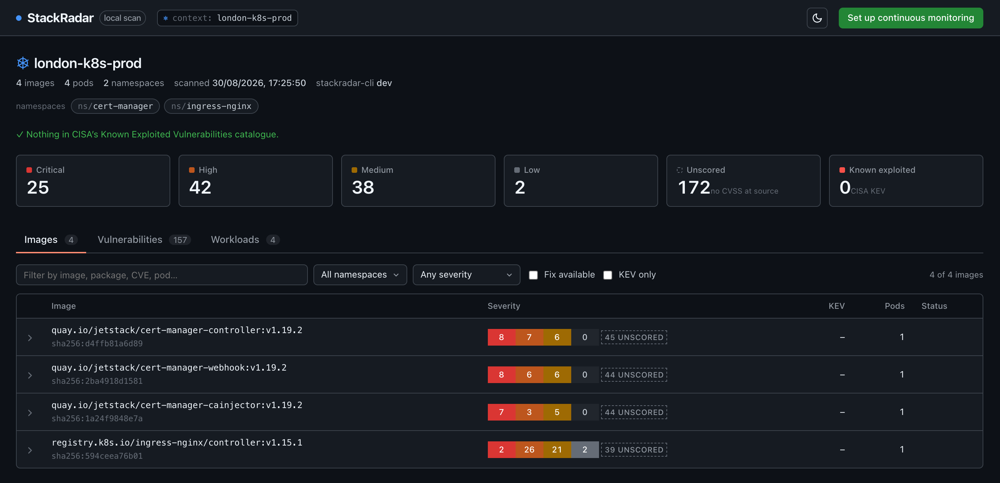
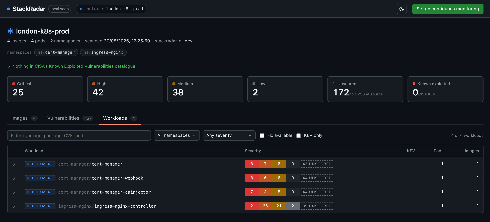

<h1>
   StackRadar CLI
</h1>

**See which of your running Kubernetes pods contain known vulnerabilities — from your laptop, in about a minute, without installing anything in the cluster.**

<p>
    <a href="https://github.com/lockdep/stackradar-cli/actions/workflows/ci.yaml"></a>
    <a href="https://github.com/lockdep/stackradar-cli/releases/latest"></a>
    <a href="https://github.com/lockdep/stackradar-cli"></a>
    <a href="https://github.com/lockdep/stackradar-cli/blob/main/LICENSE"></a>
</p>




When a CVE lands and someone asks **"are we affected?"**, this answers it from what is
*actually running* — the container digests reported by the kubelet — not from what a manifest says.

## Features

- Scans **every running image** in a cluster through your kubeconfig, deduplicated by digest — or a single image with `--image`, no cluster needed
- Matches OS and language packages against [OSV](https://osv.dev) using the embedded [osv-scanner](https://github.com/google/osv-scanner) library
- Flags CVEs in [CISA's Known Exploited Vulnerabilities](https://www.cisa.gov/known-exploited-vulnerabilities-catalog) catalogue, so you fix what is being exploited first
- Pulls images with your existing registry credentials (`~/.docker/config.json`, credential helpers, cloud keychains) — or, with `--use-pull-secrets`, the cluster's own `imagePullSecrets`
- **Table**, **JSON**, or a self-contained **HTML report** you can share — or open live in your browser with `--serve`
- CI gate with `--fail-on` (exit codes follow grype: `0` clean, `1` error, `2` threshold met)
- Single static binary. No Docker daemon, no cluster-side agent, no account, no telemetry

> [!NOTE]
> Nothing is sent to StackRadar. Image pulls go to **your** registries, package names + versions go to **api.osv.dev**,
> and one GET goes to **cisa.gov** for the KEV catalogue. That is the full list.
> Cluster secrets are never read unless you pass `--use-pull-secrets`; then the report says which ones were used,
> and the credentials stay in memory for the pull and are never written to disk.

## Installation

Homebrew (macOS and Linux):

```bash
brew install lockdep/tap/stackradar
```

Install script (downloads the release for your OS/arch into `/usr/local/bin`, or `$BINDIR`):

```bash
curl -fsSL https://raw.githubusercontent.com/lockdep/stackradar-cli/main/install.sh | sh
```

Go (builds from source; the binary is named `stackradar-cli` and reports `--version` as `dev`):

```bash
go install github.com/lockdep/stackradar-cli@latest
```

Binaries for Linux, macOS and Windows (amd64 and arm64) are on the
[releases page](https://github.com/lockdep/stackradar-cli/releases/latest). `checksums.txt`
is signed with [cosign](https://github.com/sigstore/cosign) (keyless, via GitHub Actions);
to verify a download:

```bash
cosign verify-blob checksums.txt --bundle checksums.txt.sigstore.json \
  --certificate-identity-regexp '^https://github.com/lockdep/stackradar-cli/' \
  --certificate-oidc-issuer https://token.actions.githubusercontent.com
sha256sum --ignore-missing -c checksums.txt
```

## The basics

Scan a cluster (needs `list pods` — the same permission as `kubectl get pods`):

```bash
# every running image in the current kubeconfig context
stackradar scan

# specific context and namespaces
stackradar scan --context prod -n payments -n checkout

# everything except system namespaces
stackradar scan -N kube-system -N monitoring
```

Scan a single image, no kubeconfig needed:

```bash
stackradar scan --image nginx:1.25
```

Get the report in a different shape:

```bash
stackradar scan -o json > report.json          # every finding, machine-readable
stackradar scan -o html --file report.html     # self-contained HTML to share internally
stackradar scan --serve                        # interactive dashboard on 127.0.0.1, nothing leaves the machine
stackradar scan --min-severity high            # quieter per-image detail (none = summary only)
```

`--serve` and `-o html` give you the same interactive report: filter by image, package, CVE or pod,
sort by severity, expand an image to see every finding with the fixed version next to it.
It is one self-contained file with no external assets, so it opens offline and can be attached to a ticket.



Use it as a gate in CI:

```bash
stackradar scan --fail-on high                 # exit 2 if anything ≥ high is running
stackradar scan --fail-on kev --only-fixed     # exit 2 only on exploited CVEs that have a fix
stackradar scan -q -o json                     # no progress on stderr, just the report
```

Progress goes to stderr and the report to stdout. `-q` silences progress, `-v` turns on debug
logging, `NO_COLOR` is honoured. Run `stackradar scan --help` for every flag.

## Good to know

- **Images it cannot reach.** If your local docker login cannot pull an image, the row says
  `not reachable from here: credentials rejected (401)` (or `access denied`, `not found`,
  `cannot resolve host`) and the summary names the `docker login` to run. If the pods reference
  `imagePullSecrets`, it offers `--use-pull-secrets` instead — opt-in, because reading secrets
  out of your cluster is not something a laptop tool should do unasked. An in-cluster agent that
  always has the cluster's pull secrets — which is what [StackRadar](https://stackradar.io) is —
  never hits this.
- **`--use-pull-secrets` needs RBAC.** Your kubeconfig user must be allowed to `get` secrets and
  serviceaccounts in the scanned namespaces; otherwise the CLI notes the skipped secret and
  continues with local credentials only.
- **Point in time.** Run it again tomorrow and yesterday's clean image may have a new CVE — nothing
  here watches for that.
- **Severity** is the CVSS base score OSV publishes; advisories without one are reported as
  unscored, not silently dropped into "low".
- **Go binaries** built without module version info (`(devel)`) are skipped rather than reported
  against every advisory ever filed for them.
- **Multi-arch images** are pulled for the architecture of the node each pod runs on (read from
  `nodes`; `--platform linux/arm64` overrides it, and is the way to pick when your user cannot list
  nodes — the CLI then assumes `linux/amd64` and says so). The same digest running on two
  architectures is two rows, because the packages differ. The digest shown is the manifest-list digest.
- **Repeat scans are fast.** Pulled layers are cached by digest (`stackradar cache info` shows where;
  default `~/Library/Caches/stackradar` on macOS, `~/.cache/stackradar` on Linux), so scanning the
  same cluster again downloads only manifests and whatever changed. The cache is pruned to 4 GB after
  each run; `--no-cache` skips it, `stackradar cache clear` empties it. Nothing but layer blobs is stored.
- Results will differ slightly from syft/grype or Trivy. Different inventories, different matchers — this is normal.

## Why this exists

[StackRadar](https://stackradar.io) keeps a continuous SBOM of every workload across your clusters
and re-checks it the moment a new advisory lands, with a dated history you can hand to an auditor.
This CLI is the sixty-second, zero-signup version of the same question. Use it, keep it, never
sign up — that's fine.

## Contributing

Bug reports with a redacted `-o json` output are the most useful thing you can send.

```bash
git clone https://github.com/lockdep/stackradar-cli && cd stackradar-cli
GOTOOLCHAIN=auto go build -o stackradar . && ./stackradar scan -n kube-system
go vet ./... && go test ./...
```

stackradar is developed by [lockdep](https://stackradar.io) and released under the [Apache-2.0 License](LICENSE).
